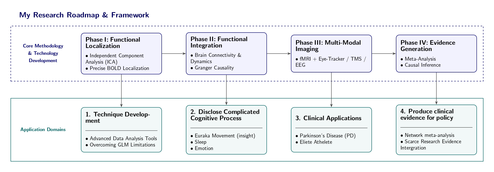

# About Me

**Institute of Education | Major in Brain Science, National Yang Ming Chiao Tung University, Taiwan**

I'm a graduate student in Brain Science at National Yang Ming Chiao Tung University, Taiwan. I came from Kinesiology background and later recieved training in Cognitive and clinical neuroscience. My research interests lie in developing new methods to disclose complicated brain activities. 

**Email:** scwang1005@gmail.com

**GitHub:** [github.com/chieh1005](https://github.com/chieh1005)

## Research Focus

- :material-brain: **Cognitive Neuroscience**

    ---

    Insight (Eureka moment), Emotion, Sleep

- :material-chart-scatter-plot: **Statistical Neuroimaging**

    ---

    Using fMRI & EEG to map brain structure, function, and connectivity.

- :material-run: **Exercise Prescription & Psychology**

    ---

    Investigating the cognitive benefits of exercise in special populations.

<figure style="text-align: center; margin: 2rem auto; max-width: 100%;">
  
  <figcaption style="margin-top: 1rem; font-size: 0.9rem; color: #666;">
    <em>My research roadmap spanning four integrated phases: Functional Localization → Functional Integration → Multi-Modal Imaging → Evidence Generation</em>
  </figcaption>
</figure>

## Leisure Activities

- **Basketball**
- **Swimming**
- **Weight Training**
- **Cooking**
- **Singing**
