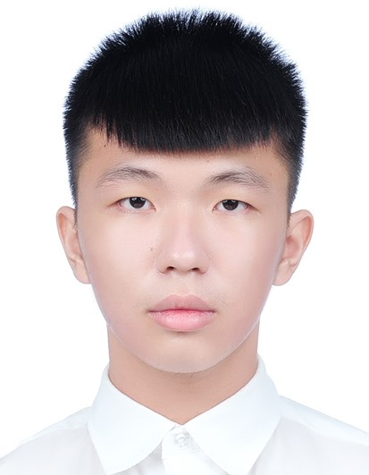

# 王上杰

即將升學之腦科學碩士班學生 · 陽明交通大學 | 運動科學系學士 · 清華大學

**陽明交通大學教育研究所，腦科學組碩士班學生**

我是陽明交通大學腦科學碩士班學生，運動科學系畢業，致力於結合運動神經科學與認知神經科學，透過腦影像研究大腦老化機制，以及運動對認知功能的保護作用。

**信箱：** scwang1005@gmail.com
**GitHub：** [github.com/chieh1005](https://github.com/chieh1005)

## 研究方向

我的工作聚焦於臨床神經科學與人類運動的交界——利用腦影像技術探究神經退化疾病的機制。

- **認知神經科學** — 注意力、記憶與執行功能在生命週期中的變化機制。
- **神經影像 · fMRI 與 EEG** — 建立 fMRI 與 EEG 分析流程，繪製大腦結構、功能與連結。
- **運動、心理學與老化** — 探討身體活動是否能減緩認知衰退與神經退化。

## About Me

- **Basketball**
- **Swimming**
- **Weight Training**
- **Cooking**
- **Singing**
